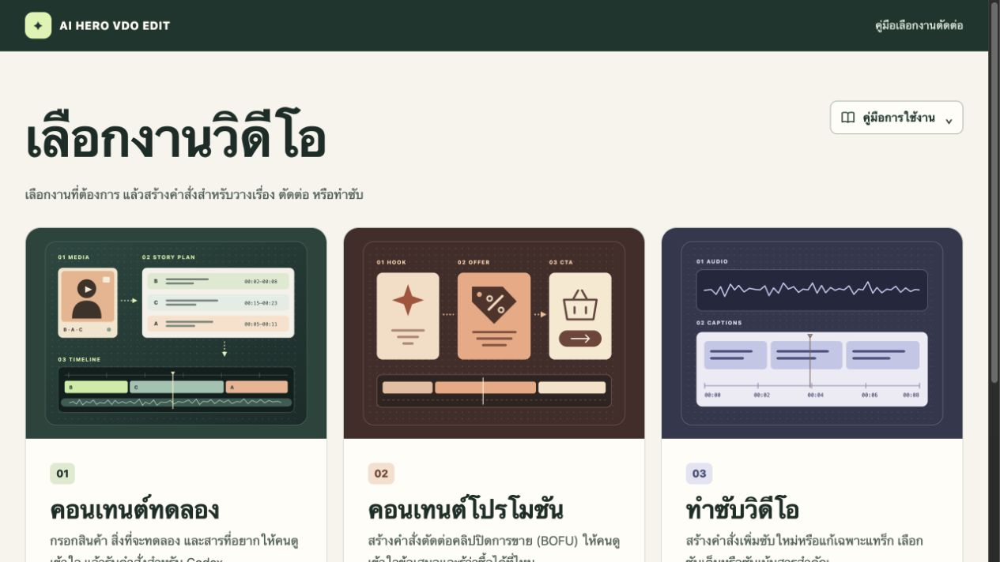
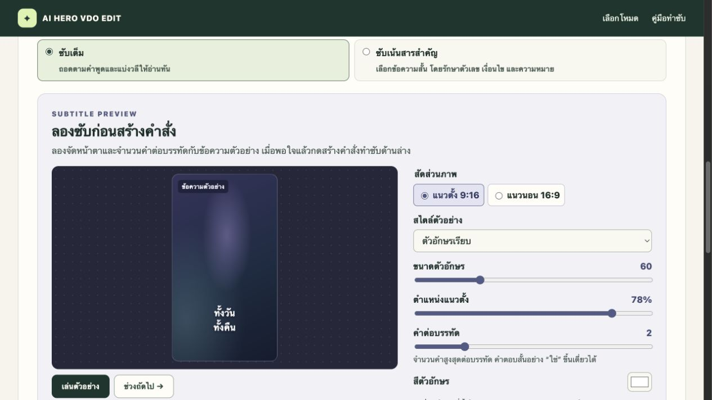

# AI HERO VDO EDIT

สกิลสำหรับวางเรื่อง ตัดต่อ และตรวจ native draft ของ CapCut ผ่านไฟล์บนดิสก์ โดยไม่เปิด ปิด หรือควบคุมแอป

## เลือกงานวิดีโอบนเว็บ

เปิดเว็บเพื่อเลือกงาน กรอกข้อมูล แล้วคัดลอกคำสั่งไปใช้ใน Codex [เปิด Site เลือกงานวิดีโอ](https://capcut-editing-sop.civillodge1.chatgpt.site/)



| งาน | สิ่งที่ตั้งค่าได้ |
| --- | --- |
| [คอนเทนต์ทดลอง](https://capcut-editing-sop.civillodge1.chatgpt.site/experiment-builder.html) | ระบุสินค้า โจทย์ทดลอง และสารหลัก เลือกตั้งโจทย์ก่อนหรือโชว์ผลก่อน |
| [คอนเทนต์โปรโมชัน](https://capcut-editing-sop.civillodge1.chatgpt.site/bofu.html) | ระบุข้อเสนอ เงื่อนไข และช่องทางซื้อ เลือกเข้าโปรไวหรือเก็บมุกและเหตุผลซื้อสำหรับงาน BOFU |
| [ทำซับวิดีโอ](https://capcut-editing-sop.civillodge1.chatgpt.site/subtitles) | เพิ่มซับหรือแก้เฉพาะแทร็ก เลือกซับเต็มหรือซับเน้นสารสำคัญ กำหนดช่วง Timeline และใช้ค่าจาก Subtitle Preview สร้างคำสั่ง |

ในหน้าทำซับ เลือกได้ทั้ง Timeline, ช่วง In–Out, จาก In ถึงท้าย หรือจากต้นถึง Out ปรับสไตล์ สี ขนาด ตำแหน่ง และคำต่อบรรทัดในพรีวิวก่อนกด **สร้างคำสั่งทำซับ** [เปิด Subtitle Preview](https://capcut-editing-sop.civillodge1.chatgpt.site/subtitles#caption-preview)



## สกิล

- [capcut-story-planner](skills/capcut-story-planner/SKILL.md): สำรวจสื่อ เลือกเทคที่จบความ เรียงเรื่อง และบันทึก source mapping กับเหตุผลของรอยต่อ
- [capcut-script-edit](skills/capcut-script-edit/SKILL.md): ตัดตามแผน สำรอง ตรวจ staging และ fingerprint ก่อนเขียน แล้วอ่าน native draft กลับตรวจ
- [capcut-subtitles](skills/capcut-subtitles/SKILL.md) จัดซับตามช่วง Timeline และค่าจาก Subtitle Preview รองรับซับเต็ม ซับเลือกเน้น และโปรไฟล์บรรทัดเดียว

โปรไฟล์เฉพาะงานอยู่ที่ [hamhang-selective-captions.json](work/workflows/hamhang-selective-captions.json): เป้าหมาย 1–4 คำ สูงสุด 5 คำ, keyword หนึ่งคำ, ซับหลักและ keyword ใช้ตำแหน่งเดียวกัน และคงหมายเหตุ SOP ครบ

## ใช้งาน

ผู้ใช้ใหม่เริ่มจาก [SOP วางเรื่องและตัดต่อ CapCut ด้วย Codex](docs/capcut-ai-workflow-sop.md) พร้อมคำสั่งคัดลอกสำหรับขอแผน ตัดจริง และแก้ QC

คัดลอกทั้งสามโฟลเดอร์จาก `skills/` ไปยังโฟลเดอร์สกิลของ Codex เช่น `~/.codex/skills/` โดยสำรองฉบับเดิมก่อนแทนที่ ทั้งสามสกิลใช้สคริปต์ถอดเสียงใน planner ร่วมกัน

บนเครื่องใหม่ให้เตรียม FFmpeg, Python และโมเดลตามคู่มือ แล้วรัน `check` และลองถอดคลิปสั้นก่อนเริ่มตัดจริง [มาตรฐานถอดเสียงและวิธีติดตั้ง](skills/capcut-story-planner/references/local-transcription.md)

ระบุโปรเจกต์ บรีฟ และ SOP ของงาน แล้วเรียก `capcut-story-planner` ตามด้วย `capcut-script-edit` ตรวจ source paths, FPS, timebase และเวอร์ชัน draft ใหม่ทุกงาน

## ตรวจสอบ

ต้องมี Python 3 และ `ffmpeg`/`ffprobe` สำหรับทดสอบและตรวจสื่อ

```bash
python3 -m venv .venv
.venv/bin/python -m pip install -r skills/capcut-story-planner/scripts/requirements.txt
.venv/bin/python -m unittest discover -s skills/capcut-story-planner/tests -v
```

ตัวตรวจแยกสามส่วน: inventory + story-plan, caption cues + profile และ native draft readback มีการตรวจ retake ที่ไม่เลือก บันทึกทบทวนความหมายที่ผูกกับช่วงล่าสุด เสียงปิด และรูปแบบซับ

ผลตรวจไฟล์ไม่รับรองความถูกต้องของการตีความเสียงหรือการเล่น/render ใน CapCut ต้องแยกหลักฐาน ASR การฟังจริง และ QC ของผู้ใช้ในรายงาน

## ขอบเขตไฟล์ใน repository

เก็บสกิล สคริปต์ทดสอบ โปรไฟล์ เอกสารที่ใช้ซ้ำได้ และซอร์สหน้าเว็บฉบับที่เผยแพร่ใน [website/](website/) ทดลองหน้าเว็บจากเครื่องได้ด้วย `python3 -m http.server 8000 --directory website` แล้วเปิด `http://localhost:8000`

งานเฉพาะคลิปใน `.scratch/` ภาพวิจัยใน `research/` สื่อต้นฉบับ native drafts สำเนาสำรอง และ environments เก็บไว้ในเครื่อง
